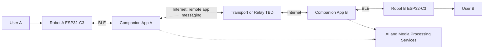
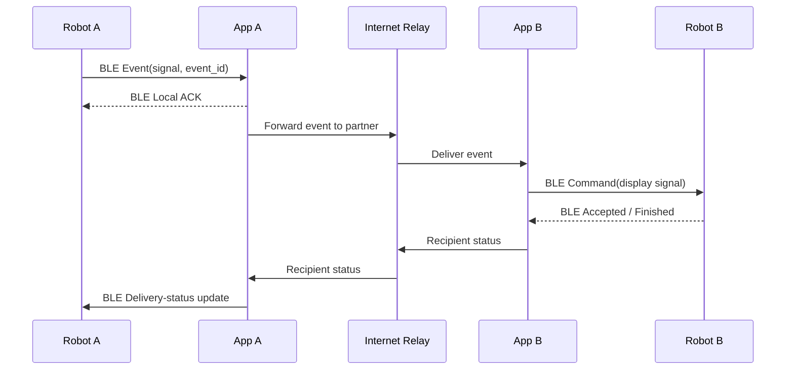
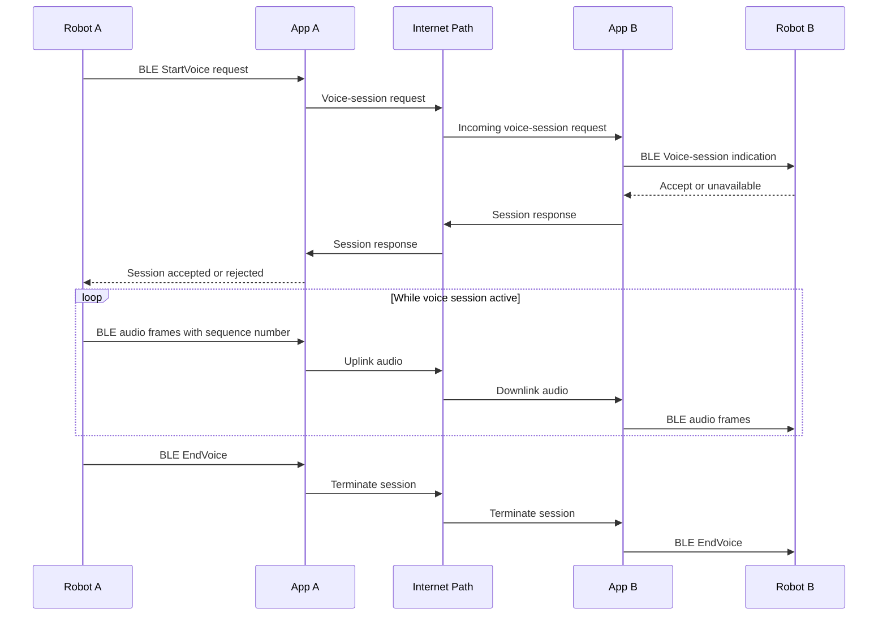
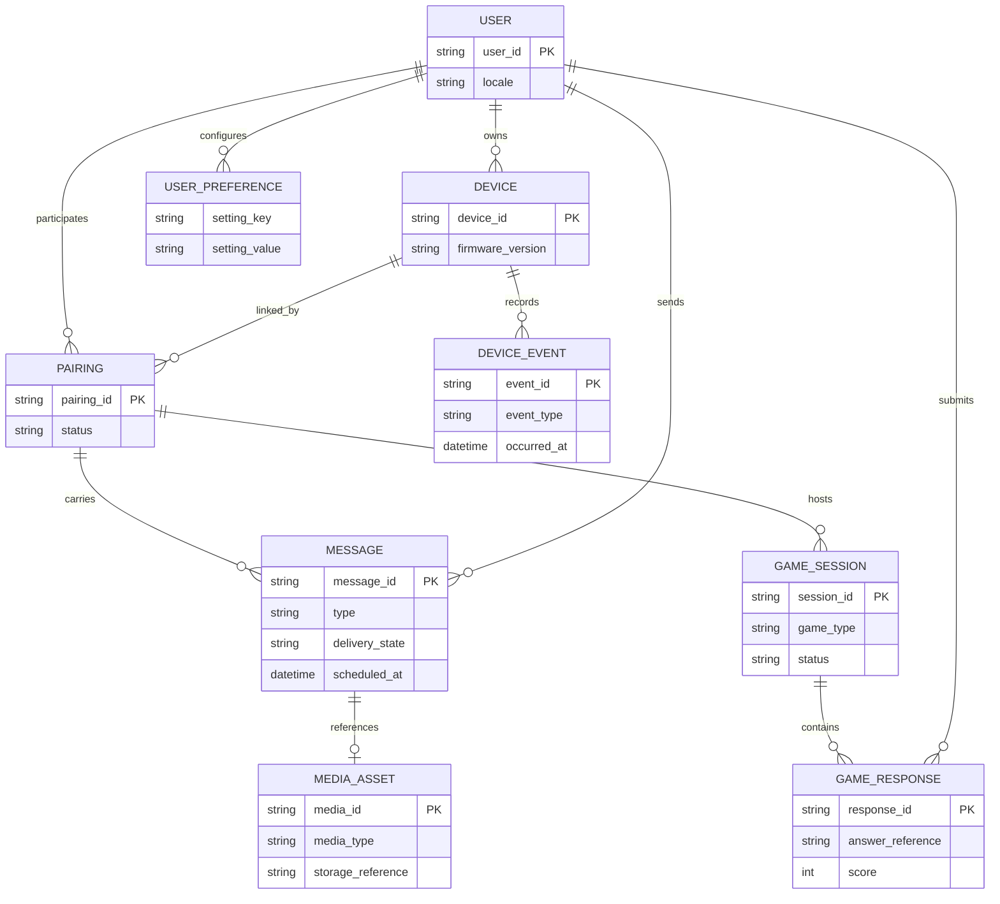
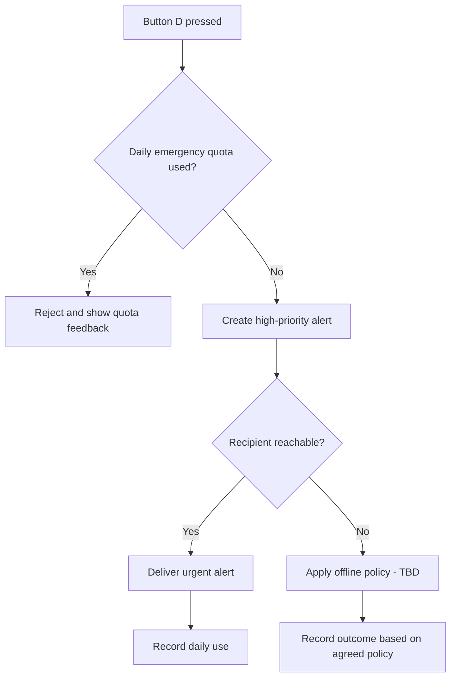
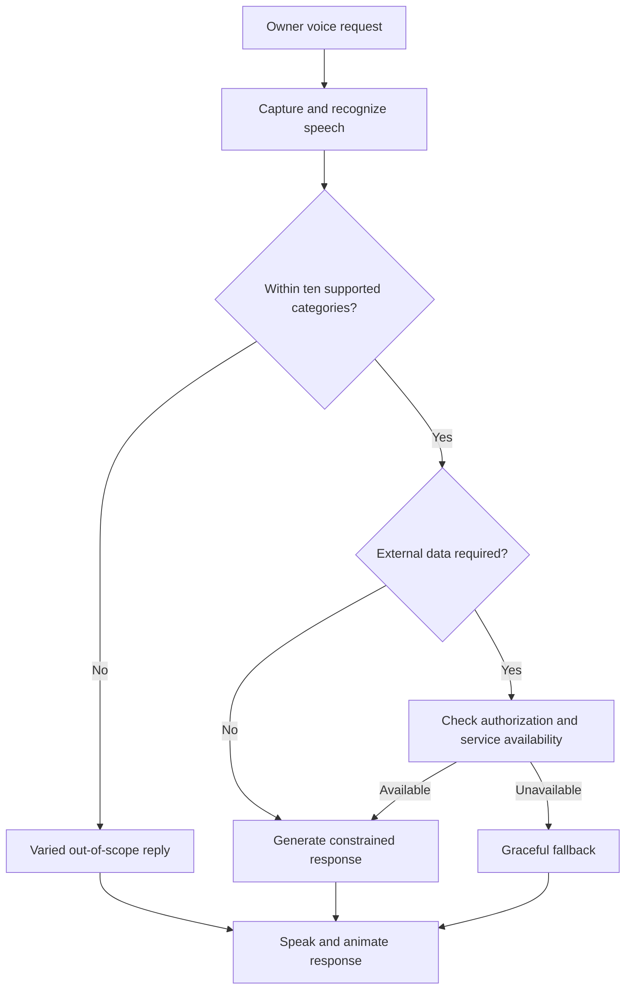
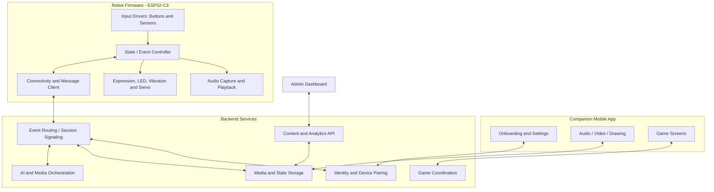
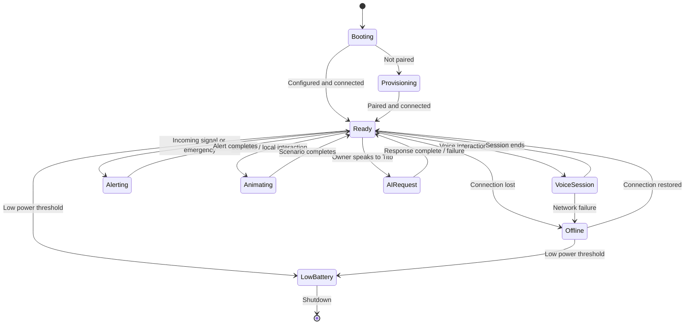

# Jiki-tiki Robot — Software Requirements Specification (SRS)

**Document ID:** Jiki-tik-SRS-001  
**Product:** Jiki-tik — paired social desktop robots and companion application  

## 1. Introduction

### 1.1 Purpose

Specify the user-facing behavior, embedded firmware, companion mobile application, backend services, AI-dependent functions, interfaces, constraints, and acceptance conditions for Jiki-tik, a **pair of interactive social robots** used by two people to communicate through gestures, audio, light, facial expressions, games, and personalized interactions.

### 1.2 Scope

The Jiki-tik system comprises two physical robots; an associated mobile app; communication and synchronization services; scoped AI services; a content-management/analytics dashboard for the product owner; and a product website. This SRS covers software behavior and software/hardware interfaces. Mechanical design, circuit schematics, finalized component selection, and production cost accounting require separate design specifications.

### 1.3 Goals and Intended Users

Jiki-tik should make distant communication easy, playful, emotionally expressive, and convenient without constantly handling a phone. Intended users include couples, friends, siblings, and family members. Personas highlighted in the brief: romantic, playful/game-oriented, and practical. Typical contexts: at a desk, during work, rapid non-verbal communication, waking the partner, joint remote activities, and celebrations.

### 1.4 Definitions

| Term            | Definition                                                                   |
| --------------- | ---------------------------------------------------------------------------- |
| Robot           | One Jiki-tik physical device                                                 |
| Pair            | Two Tito devices linked to two users                                         |
| Companion app   | Mobile application used to configure Tito and send media/play games          |
| Firmware        | Software executing on the robot microcontroller                              |
| Backend         | Services coordinating identities, message routing, content, and sessions     |
| Silent signal   | A short nonverbal communication event displayed using lights and expressions |
| Emergency alert | A high-priority user-initiated signal, limited by product policy             |
| Scenario        | Coordinated animation, movement, sound, and light behavior                   |
| `[TBD]`         | Requirement value, design choice, or method that needs confirmation          |

## 2. Overall Description

### 2.1 Product Perspective

Each user owns a robot. **Robots do not communicate directly over the internet**: each ESP32-C3 communicates by **Bluetooth Low Energy (BLE)** with its local companion app; App A exchanges remote events with App B via an internet transport/service; App B then forwards them via BLE to Robot B. The app-to-app transport mechanism (direct peer-to-peer versus server-mediated relay) is not specified and is `[TBD]`. Robots can also perform local interactive behaviors. A mobile app manages media, preferences, and games. A product-owner dashboard manages selected content and monitors interaction. A website supports product information, purchase, community-content submission, and customer support.

### 2.2 System Context Diagram — Confirmed Communication Hops

### 2.3 Operating Environment

- **Robot MCU:** ESP32-C3 Super Mini.
- **Displays:** candidate OLED 0.96-inch; small RGB TFT LCD 1.28-inch; SPI ST7789 1.54-inch. The brief additionally lists a rectangular 1.3-inch RGB display. **Only one final display arrangement is to be chosen or explicitly approved**; the screenshot lists alternatives, not a validated multi-screen design.
- **Audio:** INMP441 digital microphone; amplifier module; 8-ohm, 0.5-W, 20-mm speaker.
- **Motion and sensing:** SG90 servo; MPU-6050 gyro/accelerometer; KY017 tilt sensor; vibration motor; touch sensor.
- **Lighting:** LED(s) including two independent RGB groups and a green single-color LED per brief; exact count and driver topology .
- **Power:** LiPo battery (labeled 4.2 V in supplied documents), TP4056 charging module; regulated power architecture .
- **Inputs:** four defined buttons A/B/C/D in brief; touch sensor listed in image.
- **Connectivity:** BLE is the confirmed robot-to-local-app link; App A ↔ App B is an internet path (transport mechanism). The ESP32-C3 must run the robot-side BLE connection and protocol handlers. No robot-direct cloud connection is required by the current architecture.

### 2.4 Actors

| Actor               | Responsibilities                                                                    |
| ------------------- | ----------------------------------------------------------------------------------- |
| User A / User B     | Initiates and receives signals, voice sessions, alerts, messages, and games         |
| Mobile app user     | Pairs/configures device; uploads voice, video, handwriting; joins games             |
| Product owner/admin | Maintains content and reviews interaction metrics                                   |
| AI service          | Restricted topic responses, suggestions, refreshed content, selected media analysis |
| System service      | Authenticates devices, routes messages, enforces quotas, schedules delivery         |

### 2.5 Assumptions and Dependencies

- A two-user pairing lifecycle, accounts, and authentication are necessary to deliver features, but exact UX and implementation are not specified in the brief.
- Low-latency audio and remote delivery require suitable connectivity and server/protocol choices, still `[TBD]`.
- Video-to-robot expression and lip-motion conversion may require phone/cloud processing due to MCU memory/compute limitations; feasibility must be proven.
- Display, power, servo mechanics, microphone audio interfaces, and I/O pin allocation must be validated together before firmware pin assignments or timing are frozen.
- Weather and calendar features depend on authorized, available data services; providers and permissions `[TBD]`.

## 3. Functional Requirements

**Embedded implementation detail:** see Chapter 12 for `EMB-*`, `BLE-*`, `EVT-*`, `IO-*`, `AUD-*`, `ANI-*`, `PWR-*`, and `FW-*` requirements. These supersede earlier general architecture assumptions wherever they conflict.

Requirements use **SHALL** for mandatory intended behavior from the brief. Items requiring unspecified design decisions are marked `[TBD]` or `PROPOSED`.

### 3.1 Device Lifecycle, Pairing, and State

| ID | Requirement | Priority | Verification |
|---|---|---|---|
| FR-001 | The system SHALL support the association of two Tito robots with their respective users as a communicating pair. | High | End-to-end pairing test |
| FR-002 | The robot SHALL indicate power/ready and communication states using an agreed combination of display, lights, or sound. *PROPOSED state UX; exact pattern TBD.* | High | State-transition test |
| FR-003 | The system SHALL deliver events to the intended paired robot, not to unrelated devices. | Critical | Authorization and routing test |
| FR-004 | On temporary loss of connectivity, the robot SHALL avoid falsely displaying a remote event as successfully delivered. *PROPOSED reliability rule.* | High | Fault-injection test |
| FR-005 | The system SHALL let users configure supported settings from the mobile app. | High | App/device integration test |

### 3.2 Physical Input Mapping

| Control | Brief-defined purpose | Required firmware interpretation |
|---|---|---|
| Button **A** | Control voice communication | Action mapping (hold, mute, receive, end) `[TBD]` |
| Button **B** | Main voice communication | Initiate/control one-touch walkie-talkie interaction; gesture semantics `[TBD]` |
| Button **C** | Silent/nonverbal communication | Send short signal to paired partner |
| Button **D** | Emergency communication | Send high-priority alert subject to daily quota |

| ID | Requirement | Priority | Verification |
|---|---|---|---|
| FR-010 | The firmware SHALL recognize configured interactions from physical buttons A/B/C/D. | Critical | Button matrix test |
| FR-011 | The firmware SHALL prevent accidental multiple identical events caused by button bounce. *PROPOSED implementation safeguard.* | High | Debounce test |
| FR-012 | The firmware SHALL give each button event precedence based on defined system state and alert priority; the exact priority matrix is `[TBD]`. | High | Concurrent-event test |

### 3.3 Real-Time Voice / Walkie-Talkie

| ID | Requirement | Priority | Verification |
|---|---|---|---|
| FR-020 | The system SHALL enable voice communication between the paired users using the robots, initiated through a dedicated physical control. | Critical | Two-device voice test |
| FR-021 | The firmware SHALL capture microphone audio and output received speech using the amplifier/speaker path. | Critical | Audio loopback and remote test |
| FR-022 | The system SHALL provide a clear indication of voice session state (requesting, active, ended, failed). *PROPOSED UX behavior.* | High | Session-state test |
| FR-023 | The system SHALL respect user-configured voice/privacy settings where supported by the app. | High | Privacy setting test |
| FR-024 | The system SHALL define and enforce a voice-session control policy (push-to-talk vs duplex, conflict resolution, session timeout) before release. `[TBD]` | Critical | Protocol conformance test |

### 3.4 Silent Communication

| ID | Requirement | Priority | Verification |
|---|---|---|---|
| FR-030 | Pressing button C SHALL initiate a silent signal to the paired robot. | Critical | Two-device test |
| FR-031 | Receiving a silent signal SHALL trigger an associated light pattern and on-screen facial/emotive expression. | High | Display and LED test |
| FR-032 | The receiving user SHALL be able to reply quickly using the robot without opening the app. | High | Response workflow test |
| FR-033 | The system SHALL distinguish locally generated animations from messages received from a partner. *PROPOSED clarity requirement.* | Medium | State/UI test |

### 3.5 Emergency Alert

| ID | Requirement | Priority | Verification |
|---|---|---|---|
| FR-040 | Button D SHALL trigger a high-priority alert to the paired robot. | Critical | End-to-end alert test |
| FR-041 | The recipient SHALL receive a distinct urgent-alert presentation using available indicators. | Critical | Alert presentation test |
| FR-042 | The system SHALL permit no more than **one emergency alert activation per day** as stated in the brief. | Critical | Daily-limit test |
| FR-043 | The system SHALL define the day boundary, timestamp authority, and behavior when offline before implementation. `[TBD]` | High | Boundary/offline test |

> **Safety note:** This is a personal urgency notification feature; it is **not** a certified emergency response or life-safety system.

### 3.6 Inter-Robot Local Interaction

| ID | Requirement | Priority | Verification |
|---|---|---|---|
| FR-050 | When paired robots are physically near each other, the system SHALL detect their proximity and initiate predefined robot-to-robot interaction scenarios. | High | Proximity demonstration |
| FR-051 | Local interaction scenarios SHALL combine facial expressions, lights, and expressive sounds as appropriate. | High | Scenario playback test |
| FR-052 | The proximity technology, range threshold, repeat/cooldown behavior, and feasibility shall be decided in design. `[TBD]` | High | Radio/proximity validation |

### 3.7 Robot-to-Owner AI Interaction

The project brief limits voice interaction to the following **ten response classes**, rather than general conversation.

| Category | Expected function                                                                                     |
| -------- | ----------------------------------------------------------------------------------------------------- |
| AI-01    | Greetings                                                                                             |
| AI-02    | Tell the time                                                                                         |
| AI-03    | Tell the date                                                                                         |
| AI-04    | Weather                                                                                               |
| AI-05    | Calendar agenda                                                                                       |
| AI-06    | Alarms, timers, and reminders                                                                         |
| AI-07    | Suggest gifts, joint activities, or travel destinations                                               |
| AI-08    | Respond to affection, thanks, praise, or criticism                                                    |
| AI-09    | Explain Tito's identity, abilities, and use                                                           |
| AI-10    | For out-of-scope questions, say Tito does not know and may suggest asking someone else; vary phrasing |

| ID | Requirement | Priority | Verification |
|---|---|---|---|
| FR-060 | Tito SHALL recognize/route owner speech into these ten supported categories or a fallback class. | High | Intent-classification test |
| FR-061 | Tito SHALL answer supported requests using voice and/or character expression appropriate to the category. | High | Response test suite |
| FR-062 | Tito SHALL not present unrestricted general conversation as a supported product feature. | High | Out-of-scope queries |
| FR-063 | Tito SHALL support alarms, timers, and reminders, with time zone, recurrence, and persistence policies `[TBD]`. | High | Scheduler tests |
| FR-064 | Tito SHALL use user-authorized calendar information when providing calendar results; authorization and provider `[TBD]`. | High | Consent/integration test |
| FR-065 | Tito SHALL refresh the proposed message/suggestion list every **three days**, as stated in the brief. The definition and failure behavior of a refresh `[TBD]`. | Medium | Refresh lifecycle test |
| FR-066 | Tito SHALL give an appropriate fallback when AI/service data is unavailable. *PROPOSED resilience behavior.* | High | Service outage test |

### 3.8 App-Sent Voice Messages

| ID | Requirement | Priority | Verification |
|---|---|---|---|
| FR-070 | The app SHALL allow a user to record a voice message and address it to their paired partner. | High | App workflow test |
| FR-071 | The system SHALL transmit the recorded message so that it can be received and played on the partner's robot. | High | Remote delivery test |
| FR-072 | The app SHALL offer playback using original voice or a robot-voice rendering where technically supported. | Medium | Audio rendering comparison |
| FR-073 | The message size, length limits, retention, playback ordering, and offline queue policy are `[TBD]`. | High | Design approval |

### 3.9 App-Sent Video / Expression Imitation

| ID | Requirement | Priority | Verification |
|---|---|---|---|
| FR-080 | The app SHALL allow recording and sending a short video containing face and voice. | High | App upload test |
| FR-081 | The system SHALL derive recognizable facial expression and mouth-motion cues from the video and animate them using Tito's own character appearance. | High | Animation equivalence evaluation |
| FR-082 | The recipient robot SHALL reproduce the speech audio associated with the video, subject to supported hardware and transport. | High | Audio/animation sync test |
| FR-083 | The video duration, media pipeline, model accuracy targets, permissible faces, and compute placement are `[TBD]`. | High | Feasibility prototype |

### 3.10 Handwriting / Drawing Messages

| ID | Requirement | Priority | Verification |
|---|---|---|---|
| FR-090 | The app SHALL provide a drawing/writing canvas for handwritten content. | High | UI test |
| FR-091 | The sender SHALL be able to deliver the drawing to the recipient's robot. | High | End-to-end rendering test |
| FR-092 | The recipient robot SHALL show the handwriting/drawing on its display, subject to display resolution and chosen rendering format. | High | Screen render test |

### 3.11 Games

| ID     | Requirement                                                                                                                                                          | Priority | Verification              |
| ------ | -------------------------------------------------------------------------------------------------------------------------------------------------------------------- | -------- | ------------------------- |
| FR-100 | The app SHALL provide a four-direction game with up/down/left/right inputs and robot-issued prompts.                                                                 | High     | Multiplayer simulation    |
| FR-101 | The directional game's prompt frequency/randomness SHALL progress until a participant makes a mistake, producing a winner.                                           | High     | Rules test                |
| FR-102 | The app SHALL support a category-and-letter game ('Autobus Complete'): Tito issues a prompt; the first valid submitted answer earns a point.                         | High     | Scoring test              |
| FR-103 | The system SHALL provide a drawing imitation game: display a target on Tito, collect drawings from both players in the app, evaluate similarity, and present scores. | High     | Scoring test              |
| FR-104 | The app SHALL provide a 'Do You Know Me?' question game where one player answers and the other guesses the answer.                                                   | High     | Two-party game test       |
| FR-105 | The system SHALL support periodically renewed questions using AI tools for the 'Do You Know Me?' game.                                                               | Medium   | Content update test       |
| FR-106 | The multiplayer game service SHALL establish and synchronize both participants' game states, turns, scores, and outcomes.                                            | High     | Network delay/rejoin test |
| FR-107 | Rules for answer validation, ties, latency, scoring model, content moderation, and AI-generated question review are .                                                | High     | Product decision          |

### 3.12 Personalization, Scheduling, and Robot Personality

| ID | Requirement | Priority | Verification |
|---|---|---|---|
| FR-110 | The app SHALL permit supported personalization of robot message voice tone (original/robot), motions, and expressions. | High | Preference test |
| FR-111 | The app SHALL permit a user to schedule the sending of a message. | High | Scheduled-delivery test |
| FR-112 | The robot SHALL support varied, playful, and contextual expressive scenarios instead of a single fixed response. | Medium | Scenario library test |
| FR-113 | The robot SHALL provide facial animations grouped into **feelings, actions, thoughts, and filters**. | High | Content inventory test |
| FR-114 | The robot SHALL provide specified combined head movements including side-to-side twist and forward/backward tilt if the final mechanical design supports them. | High | Motion prototype test |
| FR-115 | The robot's defined gesture vocabulary SHALL include 'Tee': rightward twist with backward tilt, and 'Too': rightward twist with forward tilt. | Medium | Motion demonstration |
| FR-116 | Robot lighting SHALL support independently controllable zones and the following colors where RGB LEDs are used: green, red, orange, purple, white, yellow, blue. | High | LED test |
| FR-117 | Content authors SHALL be able to assemble expressions, lights, movement, and sound into scenarios. *PROPOSED tooling requirement derived from brief scenarios.* | Medium | Scenario playback test |

## 4. External Interface Requirements

### 4.1 User Interfaces

- **Robot screen:** facial expressions, alerts, drawing messages, prompts, connection/operational feedback.
- **Robot input:** physical buttons A/B/C/D and possibly touch input (function `[TBD]`).
- **Mobile app:** onboarding/pairing, sender selection, settings, messages, scheduled delivery, media capture, games.
- **Admin dashboard:** content and usage monitoring.
- **Website:** catalogue, purchase/contact/community interaction.

### 4.2 Hardware Interface Matrix

| Component | Electrical label in source | Intended software role | Integration concern |
|---|---|---|---|
| ESP32-C3 Super Mini | 4.2 V listed in screenshot | Main controller | Actual supported regulated supply / logic levels must be verified; **do not feed LiPo directly based on spreadsheet label** |
| OLED 0.96-inch | 3.3 V | Candidate small display | Alternative or additional display? `[TBD]` |
| RGB TFT LCD 1.28-inch | 3.3 V | Candidate display | Exact controller and interface `[TBD]` |
| SPI ST7789 1.54-inch | 3.3 V | Candidate display | SPI bandwidth, framebuffer/animation memory |
| INMP441 | 3.3 V | I2S microphone input | Pin sharing, audio sampling |
| Audio amplifier | Not specified | Speaker output chain | Exact amplifier, DAC/PWM/I2S approach `[TBD]` |
| Speaker, 8Ω 0.5 W, Ø20mm | 4.2 V in screenshot's row | Audio output transducer | **Impedance/power rating, not a direct logic supply voltage** |
| SG90 servo | 5 V | Head gesture actuation | 5 V power rail, peak current, motion mechanics |
| MPU-6050 | 3.3 V | Motion/orientation sensing | I2C bus selection and calibration |
| Vibration motor | 3.3 V | Haptic feedback | Transistor/driver and flyback protection as needed |
| KY017 tilt sensor | 3.3 V | Tilt sensing | Signal conditioning and actual module type |
| LEDs / two RGB zones | 3.3 V indicated | Lighting effects | LED type/current drivers `[TBD]` |
| Touch sensor | 3.3 V | Optional touch interaction | Touch mapping `[TBD]` |
| LiPo battery | '4.2 V' | Power | Voltage range, cell capacity, protection, voltage conversion |
| TP4056 | Not specified | Charging | Charging/protection implementation and safe power-path operation |

> **Important mismatch:** The brief specifies four buttons and two RGB LED groups plus one green LED; the screenshot does not establish all button/LED quantities or their circuit topology. Confirm the final BOM and GPIO budget. 
### 4.3 Software Interfaces

| Interface | Data / operation | Status |
|---|---|---|
| Robot ↔ communication backend | Connection, pairing credentials, signal events, voice session/audio, message delivery | Protocol `[TBD]` |
| App ↔ backend | Authentication, pairing, media upload, message schedule, game state, settings | API schema `[TBD]` |
| Backend ↔ AI service | Intent classification, constrained text generation, suggestion refresh, question generation | Provider and safeguards `[TBD]` |
| App/backend ↔ media processing | Video expression extraction; optional voice style processing | Feasibility `[TBD]` |
| Admin dashboard ↔ backend | Authorized content publishing and analytics | Roles/API `[TBD]` |
| Weather/calendar providers | Current conditions; user calendar events | Providers and user consent `[TBD]` |

### 4.4 Communication Sequence — Silent Signal

The local BLE acknowledgement means only that App A received the event; it is **not** proof that Robot B displayed it.

### 4.5 Communication Sequence — Walkie-Talkie (Transport Concept)

## 5. Non-Functional Requirements

### 5.1 Source-Defined Constraints

| ID | Requirement / Target | Verification |
|---|---|---|
| NFR-001 | Battery SHALL support at least **4 hours of continuous use**, per project brief. | Defined-use endurance test |
| NFR-002 | The final robot should fit within the **approximate size envelope stated in the brief: 6×2×3 cm to 7×3×4 cm**. Orientation and tolerances `[TBD]`. | Mechanical inspection |
| NFR-003 | Target BOM cost is **EGP 2,000**; final product cost including finishing, packaging, and assembly SHALL not exceed **EGP 2,500**, per brief. | Costed production BOM |
| NFR-004 | Product warranty target is at least **6 months**. | Warranty policy |
| NFR-005 | Product design-life target is **3 years**. | Reliability plan |
| NFR-006 | The product SHALL aim for stable connectivity, accurate expression simulation, and responsive button/motion interaction. Numerical acceptance limits `[TBD]`. | Test plan after thresholds agreed |

### 5.2 Non-Functional Requirements Requiring Defined Targets

| ID | Quality attribute | Baseline specification |
|---|---|---|
| NFR-010 | Voice latency | End-to-end percentile and network test conditions `[TBD]` |
| NFR-011 | Silent alert latency | Sender-to-recipient display percentile `[TBD]` |
| NFR-012 | Button response | Maximum local UI feedback latency `[TBD]` |
| NFR-013 | Availability | Backend/service uptime and scheduled maintenance window `[TBD]` |
| NFR-014 | Offline support | Queue/retry rules by message class and maximum retention `[TBD]` |
| NFR-015 | Security | `PROPOSED`: authentication for users and devices; encrypted communication; authorization on every paired-user action |
| NFR-016 | Privacy | `PROPOSED`: explicit mic/media permissions; clear recording indicators; media deletion/retention policy; no unapproved reuse of user content |
| NFR-017 | Safety | `PROPOSED`: fail-safe servo limits, motor and audio output limits, low-battery behavior, charger/power protection validation |
| NFR-018 | Maintainability | `PROPOSED`: versioned firmware/app/backend interfaces; error logging without storing sensitive raw content by default |
| NFR-019 | Accessibility | Robot/app interaction alternatives and minimum contrast/tap targets `[TBD]` |
| NFR-020 | Localization | Arabic dialect support implied by example commands; actual languages and speech-recognition coverage `[TBD]` |

### 5.3 Product / Engagement KPIs (Not Functional Pass/Fail Tests)

- Weekly use at least once over a six-month period (desired adoption/retention behavior; cohort definition `[TBD]`).
- Users voluntarily share Tito-related photos, videos, or comments on social platforms (engagement signal, not an obligation).
- Approximately **20% response** to robot notifications/suggestions (denominator and observation period `[TBD]`).

## 6. Data Requirements

### 6.1 Conceptual Data Model

> Conceptual *proposal* only. This diagram is not a committed database schema; key types, relational cardinality (especially pairing history), storage architecture and data retention need design approval.

### 6.2 Data Classes

- Identity and device pairing records.
- Message metadata (sender, recipient, type, timestamp, delivery status, scheduled time).
- Optional audio, video, or handwriting payloads.
- Animation/gesture/light scenario definitions and versioned content.
- Game sessions, answers, rules, scores.
- Preferences including voice rendering, motion and display expression settings.
- Operational metrics (connectivity, failures, interaction counts), subject to privacy controls.

### 6.3 Data Handling Open Decisions

Media retention/deletion, access control, consent, data hosting region, encryption/key management, analytics scope, recovery and backup, child/minor access policies, content-moderation rules and user data export are `[TBD]`.

## 7. Use Cases and Workflows

### UC-001 — Send a Silent Signal

**Actors:** Sender and recipient.  
**Preconditions:** Both users paired; sender's robot operational; transport available (or configured queue).  
**Trigger:** Sender presses button C.

1. Sender robot detects button event.
2. Firmware creates a silent-signal event directed to the paired recipient.
3. Backend validates the link and routes the event.
4. Recipient robot plays a predefined light and facial-expression sequence.
5. Recipient may send a quick reply from the robot.

**Postcondition:** Event delivered and displayed, or error/queued state recorded (strategy `[TBD]`).  
**Mapped requirements:** FR-003, FR-030 to FR-033.

### UC-002 — Send an Emergency Alert

**Actors:** Sender and recipient.  
**Trigger:** Sender presses button D.

1. Firmware requests high-priority alert sending.
2. System checks daily quota for sender/device/pair (quota scope `[TBD]`).
3. If permitted, route alert and play a distinct urgent signal on recipient robot.
4. Otherwise, reject activation and show an appropriate local indication.

**Mapped requirements:** FR-040 to FR-043.

### UC-003 — Speak to Partner

**Actors:** Two paired users.  
**Trigger:** Voice control button; details of A versus B semantics `[TBD]`.

1. Sender starts voice interaction.
2. System requests/establishes communication with remote robot.
3. Microphone captures speech and the distant speaker plays it.
4. Session is terminated via configured control or timeout.

**Alternative cases:** recipient unavailable; internet interrupted; microphone permission/policy disabled; simultaneous initiation.  
**Mapped requirements:** FR-020 to FR-024.

### UC-004 — Deliver a Video Reaction

**Actor:** Sender using app; recipient using Tito.  
**Flow:** Capture short app video → send to processing service → extract expression/mouth cues → map to robot face animations → deliver animation and audio → robot plays coordinated expression and speech.  
**Technical gate:** Feasibility and latency/memory tests required before declaring supported quality.  
**Mapped requirements:** FR-080 to FR-083.

### UC-005 — Play Direction Game

**Actors:** Both app users, Tito as prompt source.  
**Flow:** Join shared session → display four directional touch areas → robot issues direction prompts → both users respond → increase prompt rate/randomness → first incorrect response loses → winner displayed.  
**Open decisions:** simultaneous responses, reaction timing and tie handling.  
**Mapped requirements:** FR-100, FR-101, FR-106, FR-107.

### UC-006 — Ask Tito a Question

**Actor:** Robot owner.  
**Flow:** User gives spoken request → speech recognition/intent extraction → route to one of ten categories → fetch data/compose restricted response → speak and animate answer; or use varied out-of-scope fallback.  
**Mapped requirements:** FR-060 to FR-066.

## 8. Software Architecture — Proposed Decomposition

> This section is an engineering **proposal** to support implementation; the brief does not prescribe programming languages, protocols, cloud provider, or framework.

### 8.1 Robot Firmware State Machine

State names and transitions are illustrative. Battery cutoff, interrupt handling, and alert priority .

## 9.  Acceptance Tests

| Test | Demonstration | Related requirements |
|---|---|---|
| AT-01 | Pair two distinct robots and confirm messages cannot be routed to unrelated devices | FR-001, FR-003 |
| AT-02 | Press C on robot A; B displays signal; B sends response | FR-030–032 |
| AT-03 | Press D; recipient receives distinct high-priority alert; repeat within day is limited | FR-040–043 |
| AT-04 | Establish, use and end a two-robot audio session | FR-020–024 |
| AT-05 | Bring robots together and observe a predetermined light/sound/expression scenario | FR-050–052 |
| AT-06 | Test all ten supported AI intent classes plus varied fallback | FR-060–066 |
| AT-07 | Send recorded audio app → recipient robot; exercise voice-choice option | FR-070–073 |
| AT-08 | Send face video app → Tito expression/lip-motion animation plus speech | FR-080–083 |
| AT-09 | Draw message in app → corresponding drawing on recipient robot screen | FR-090–092 |
| AT-10 | Play all four named two-user games through completion | FR-100–107 |
| AT-11 | Change voice/motion/expression and schedule a message | FR-110–117 |
| AT-12 | Update allowed content through admin dashboard and inspect usage figures | FR-120–123 |
| AT-13 | Run defined continuous-use battery test for at least four hours | NFR-001 |
| AT-14 | Validate component electrical compatibility, display, GPIO allocation and servo peak current | Hardware interface matrix |

## 10. Decisions Required

| ID   | Risk or ambiguity                                                               | Impact | Required decision                                                          |
| ---- | ------------------------------------------------------------------------------- | ------ | -------------------------------------------------------------------------- |
| R-01 | Companion phone becomes single point of failure for remote robot communications | High   | Validate locked-phone, Bluetooth-off, internet-off and killed-app behavior |

